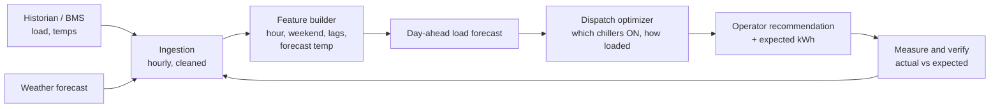
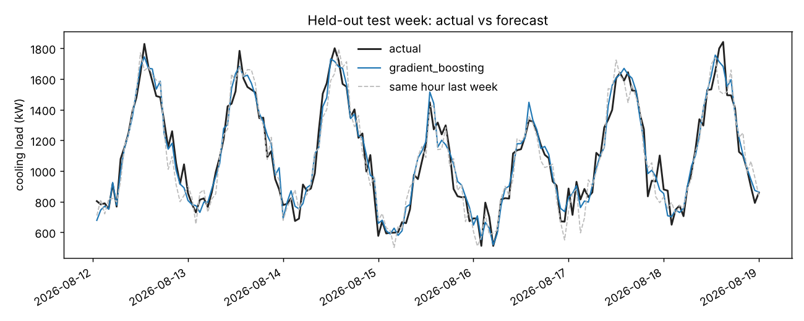

# 01 - Forecast Cooling Demand, Then Run the Chillers Cheaper

> Clean-room case study on synthetic data. The real work was in a government research setting (MATLAB); nothing from it is reproduced here.
> Walk-through order: business problem, current architecture, proposed architecture, sample data, algorithms, model selection, test results, business impact.

## 1. Business use case

A large campus cools its buildings with a plant of several chillers. Each chiller has a sweet spot: run it too light or too hard and it burns more electricity per unit of cooling. Operators usually start and load chillers by rule of thumb.

**The client question:** "Can we predict tomorrow's cooling demand, then decide which chillers to run and how hard, to cut the electricity bill without ever missing the cooling need?"

Analogy: a delivery fleet with three vans of different sizes and fuel economy. If you know tomorrow's parcels per hour, you can pick which vans to send and how to split the load. Guess wrong and you waste fuel or leave parcels behind.

## 2. Current architecture

| Layer | Today (typical) |
|---|---|
| Sources | Plant historian / building management system (temperatures, chiller power, flow), weather feed |
| Processing | Manual exports and ad hoc analysis scripts (MATLAB in the original setting) |
| Decision | Operator experience and fixed staging rules |
| Pain | No forward-looking demand number; dispatch reacts after load changes |

<!-- ADD-REAL: exact historian/BMS, data volumes and tools from your NIH work -->

## 3. Proposed architecture



The optimizer is a mixed-integer problem: ON/OFF per chiller (integer) plus load split (continuous). Here it is solved by trying every ON/OFF combination and optimizing the split for each. Details in `docs/architecture.md`.

## 4. Sample data

`scripts/01_generate_data.py` creates 120 days of hourly cooling load (2,880 rows) with a daily cycle, weekend dip, temperature dependence and noise, plus a noisy temperature forecast.

```python
# chiller_opt/data.py
generate_cooling_load(days=120, seed=21)   # timestamp, temp_c, temp_forecast_c, load_kw
```

Plant: CH-1 1000 kW, CH-2 1000 kW, CH-3 500 kW with different best-efficiency points (`chiller_opt/plant.py`).

## 5. Algorithms

Forecasting candidates (`chiller_opt/forecast.py`), features known a day ahead only (hour, weekend, forecast temperature, loads at 24/48/168 h ago, lagged 24 h mean):
- Two naive baselines: same hour yesterday, same hour last week
- Ridge regression
- Random forest
- Gradient boosting (HistGradientBoosting)

Optimizers (`chiller_opt/optimize.py`): SLSQP and differential evolution for the load split.

### MATLAB mapping

The original work used MATLAB. The Python files below run and are tested. The MATLAB files are written for reference and have **not been executed** (no MATLAB available when building this).

| Task | Python (runs here) | MATLAB (not run) |
|---|---|---|
| Load forecast | `forecast.py` gradient boosting | `matlab/lstm_load_forecast.m` (needs R2023b+) |
| Dispatch optimization | `optimize.py` SLSQP | `matlab/chiller_dispatch_fmincon.m` |
| Global search | `optimize.py` differential evolution | `matlab/chiller_dispatch_ga_pso.m` |

## 6. Training, model selection, tuning

Chronological split, never shuffled: train 70% (1,898 h), validation 15% (407 h), test 15% (407 h, 2026-08-12 to 2026-08-28). Hyperparameters tuned with `TimeSeriesSplit` cross-validation on the training block; models compared on validation; winner refit on train + validation; test touched once.

```bash
python scripts/01_generate_data.py
python scripts/02_train_and_tune.py
python scripts/03_evaluate_holdout.py
python scripts/04_optimize_and_estimate_impact.py
```

Validation MAE (kW):

| Model | MAE | MAPE |
|---|---|---|
| gradient_boosting (lr 0.05, depth 3, 200 iter) | **65.65** | 6.49% |
| random_forest | 67.41 | |
| ridge | 67.81 | |
| same_hour_last_week | 99.86 | |
| same_hour_yesterday | 138.30 | |

## 7. Test results

| Model | MAE kW | RMSE kW | MAPE |
|---|---|---|---|
| gradient_boosting | **62.11** | 78.87 | 5.99% |
| same_hour_last_week | 92.34 | | 8.94% |
| same_hour_yesterday | 133.40 | | |

The model cuts error by about 33% versus the best naive baseline. Caveat: the synthetic data has noise (sd 60 kW) that no model can remove, so the three ML models are all close to that floor and their differences are small. The gap over the naive baselines is the real finding.



Solver check on 24 hours: SLSQP 4,955.8 kWh in 0.14 s; differential evolution 4,955.8 kWh in 0.77 s. Same answer, so SLSQP was picked for speed.

## 8. Business impact

Test block of 407 hours, electricity at an **assumed $0.12/kWh**:

| Plan | Energy (kWh) | Saving vs baseline |
|---|---|---|
| Baseline (proportional loading) | 80,279 | n/a |
| Forecast-planned dispatch | 79,434 | 1.05% |
| Perfect-foresight (oracle) | 79,248 | 1.28% |

Annualised: about 18,186 kWh, roughly **$2,182/year** for the forecast plan, against $2,663/year if forecasts were perfect. Forecast error cost about 186 kWh in the block.

**Be straight about this:** on this made-up plant the saving is about 1%, and the dollar figures are illustrative, driven by my plant and tariff assumptions. The value of the project is the method (forecast, then optimize, then measure), which I would size against a real plant's data and bills. See `docs/business-impact.md` for the formula.

<!-- ADD-REAL: the measured energy or cost result from your NIH work, with method and baseline -->

## Tests

```bash
pytest projects/01-energy-forecast-and-chiller-optimization -q     # 33 pass
```
