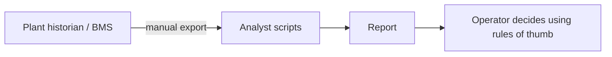
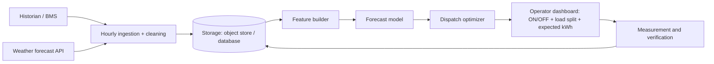

# Architecture notes

## Current (typical)

## Proposed

Possible cloud mapping (illustrative, not a claim about what was deployed): scheduled ingestion job, object storage, a container or function for forecast + optimize, a small dashboard.

## Dispatch problem

Choose ON/OFF `u_i` and loads `q_i` to minimise total electrical power `sum(q_i / COP_i(q_i))` subject to `sum(q_i) = forecast demand` and `min_plr*cap_i <= q_i <= cap_i` for units that are ON. ON/OFF is the integer part; the split is continuous and non-linear because COP varies with part-load ratio.

Approach in code: enumerate all ON/OFF sets that can cover demand (3 chillers gives 7 non-empty sets), solve the split for each, keep the cheapest. For larger plants this becomes real mixed-integer programming or a global heuristic (see the GA/PSO MATLAB file).

## Safety rule

If the forecast is lower than the actual load, the plan could under-cover. The code re-dispatches against actual load whenever the planned ON set cannot meet it (13 of 407 hours in the test block). A real deployment would also add operator override and alarms.
