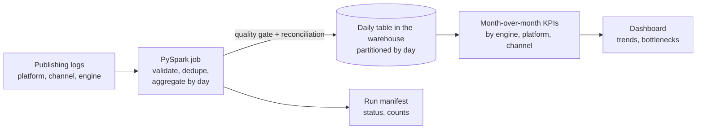
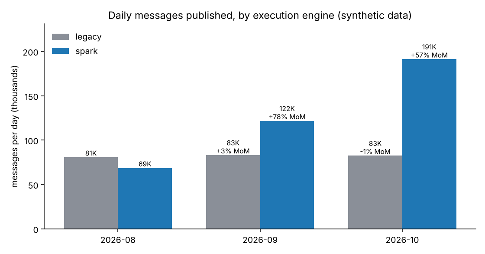

# 02 - Automating File-Publishing Analytics (PySpark + warehouse + dashboard)

> Clean-room case study on synthetic data. It reproduces the *kind* of work (a big-data pipeline feeding month-over-month product metrics), with no employer code, schemas, names or data.
> Walk-through order: business problem, current architecture, proposed architecture, sample data and code, how it was built and tuned, test results, business impact.

**This is a batch pipeline, not streaming.** The source data describes streams of published files; the analytics are computed in daily batches.

## 1. Business use case

A data-platform product lets teams publish governed data files into the company's storage and warehouse. Two platforms and several channels carry billions of records a day, processed by an older engine and a newer Spark engine. Product managers need to report **month-over-month (MoM) volume and message counts** by platform, channel and engine, and especially to show whether the Spark engine is taking over and performing.

**The client question:** "Can we stop spending days each month hand-building these numbers, and trust them?"

Analogy: a shop counting its till takings. Counting every receipt by hand each month takes days and gets miscounted. A nightly till total, checked against the receipts, makes the month-end report a sum of 30 numbers.

## 2. Current architecture

| Layer | Before |
|---|---|
| Sources | Publishing logs for each platform and channel, billions of records daily |
| Extraction | Analysts query each platform separately, by hand |
| Reporting | Numbers pasted into Google Sheets for management |
| Pain | Manual querying took over 40 hours; each query run took 30 to 60 minutes; spreadsheets were error-prone and inconsistent; no single place to compare engines |

## 3. Proposed architecture



- **Aggregate once, by day.** The heavy scan happens once per day in Spark. Everything after reads a small daily table.
- **Idempotent daily partitions.** Re-running a day replaces that day, so a retry never double-counts.
- **Quality gate and reconciliation.** Too many bad rows stops the load. After writing, the daily totals are re-read and must equal the cleaned totals.
- **Run manifest.** A small JSON a scheduler can read to alert, retry or continue.

In the real system the target was a cloud warehouse and a BI dashboard (Snowflake and QuickSight). Here the daily table is Parquet and the dashboard tile is a chart, so everything runs on a laptop. More in [`docs/architecture.md`](docs/architecture.md).

## 4. Sample data and code

`scripts/01_generate_data.py` writes 465 raw rows: 92 days from 1 Aug 2026, with one baked-in story (work moves from a legacy engine to a Spark engine while volume grows), and known problems so tests can assert exact counts: 13 duplicate deliveries, 4 missing platform, 2 negative message counts, 2 bad timestamps.

```python
# publishing_etl/transform.py (excerpt)
def parse_and_validate(raw):   # trim, lower-case, type once, keep only valid rows
def dedupe_events(df):         # dropDuplicates(["file_id"])
def daily_publishing(df):      # groupBy(day, platform, channel, engine) -> files, messages
```

## 5. Methods and choices (no ML here)

This project has no model; the choices are engineering ones, each with a reason:

| Choice | Picked | Why |
|---|---|---|
| Raw as text, typed once | all columns read as strings | every bad value is caught the same way |
| Duplicates | `dropDuplicates` on file id | repeats are exact copies; if a later delivery can correct an earlier one, keep the latest instead |
| MoM measure | per-day average over all days in the month | months have different lengths, and an engine quiet on some days must not look busier |
| Output layout | Parquet partitioned by day, dynamic overwrite | safe reruns, cheap single-day reloads |
| Failure handling | quality gate at 20% invalid, manifest status | a bad upstream file should not quietly produce a plausible-looking table |

## 6. Build, test and tune

```bash
pip install -r requirements.txt            # needs Java 17 or 21
python scripts/01_generate_data.py
python scripts/02_run_pipeline.py          # PySpark job + manifest
python scripts/03_build_kpis.py            # MoM KPIs + chart
python scripts/04_benchmark.py             # tuning and speed on 300,000 rows
pytest projects/02-publishing-analytics-spark
```

**Correctness.** The pipeline reports exactly the problems injected in step 1 (8 invalid, 13 duplicates, 444 clean rows), and the daily table reconciles with the cleaned data on both file count and message total. 12 tests cover the transforms, exact counts, idempotent reruns, the quality gate, and the KPI maths.

**Tuning** (300,403 raw rows, 17.6 MB, local 2-core Spark, best of 3, synthetic):

| Shuffle partitions | 2 | 4 | 8 | 32 | 200 (Spark default) |
|---|---|---|---|---|---|
| Pipeline seconds | 4.3 | 4.3 | 4.9 | 4.6 | **13.4** |

The default of 200 is about 3 times slower on data this small, because Spark launches hundreds of tiny tasks. 2 to 32 are within noise, so I chose 4. On a real cluster and data size this needs re-measuring; the lesson is to measure it rather than accept the default.

**Why a daily table.** Answering "monthly messages by engine" from the daily table took 0.86 s against 1.29 s from the raw files (1.5 times faster). At 300,000 rows that gap is small, because Spark's fixed overhead dominates. The point of the daily table is billions of rows a day and many repeated questions. I did not test at that scale.

## 7. Results: the month-over-month view

Per-day average messages, by engine (synthetic; the story was built into the data, so this shows the report works, not a finding):

| Month | Legacy per day | MoM | Spark per day | MoM | Spark share of messages |
|---|---|---|---|---|---|
| 2026-08 | 80,840 | n/a | 68,623 | n/a | 45.9% |
| 2026-09 | 83,262 | +3.0% | 121,865 | +77.6% | 59.4% |
| 2026-10 | 82,621 | -0.8% | 191,373 | +57.0% | 69.8% |



One bug worth telling in an interview: my first version divided by the days an engine appeared on, not the days in the month, which made the shrinking legacy engine look like it grew 26% in October. A unit test now guards it.

## 8. Business impact

| Measure | Before | After | Source |
|---|---|---|---|
| Manual reporting time | over 40 hours per month, plus 30 to 60 minutes per query run | automated | project background |
| Time saved | n/a | **40 hours per month** | project record (confirm and cite how it was measured) |
| Report quality | spreadsheets, inconsistent | one reconciled daily table, one set of definitions | design |
| Decisions | slow, per-platform | trends and bottlenecks across platforms and engines | design |

Turning 40 hours into money needs a loaded hourly rate, which depends on who did the work. At an **assumed** USD 60 per hour, 40 hours is USD 2,400 a month, about USD 28,800 a year. That rate is a placeholder, not a fact about anyone's pay.

<!-- ADD-REAL: how the 40 hours/month was measured (before/after, who confirmed it), adoption (teams or business lines using the dashboard), and any decision the metrics changed. Keep employer-internal product names out of this public repo. -->

## Limits

- Batch only. A streaming version would need Structured Streaming with a watermark for deduplication.
- Synthetic volumes (hundreds of rows to 300,000), not billions. Partitioning, file compaction and cluster sizing are not exercised.
- Warehouse and dashboard are stand-ins (Parquet and a chart). A Snowflake load is sketched in `docs/architecture.md` and not run.
