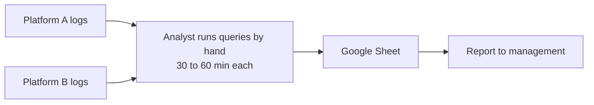
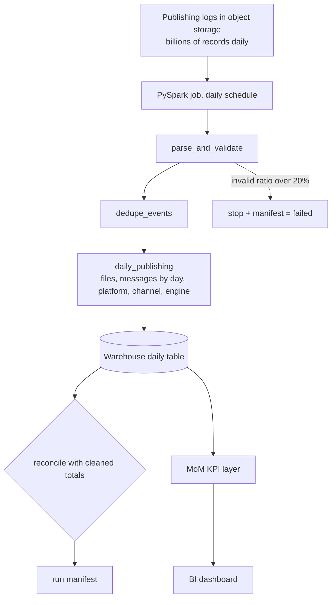

# Architecture notes

## Current (before automation)



## Proposed



## Mapping from this repo to a production stack

| In this repo | In production (as described for the original work) |
|---|---|
| CSV in `data/sample` | publishing logs in cloud object storage |
| local PySpark (`local[2]`) | PySpark on a managed cluster |
| Parquet partitioned by day | warehouse table (Snowflake) |
| `analytics.py` + matplotlib chart | KPI queries + BI dashboard (QuickSight) |
| `_manifest.json` | read by the scheduler to alert, retry or continue |

## Loading the daily table into a warehouse (sketch, not run)

```sql
-- Snowflake, after staging the Parquet files
COPY INTO daily_publishing FROM @publishing_stage/daily_publishing/
  FILE_FORMAT = (TYPE = PARQUET) MATCH_BY_COLUMN_NAME = CASE_INSENSITIVE;
-- To reload one day safely: delete that publish_date, then COPY, inside one transaction.
```

## Data model

| Column | Meaning |
|---|---|
| publish_date | calendar day the file was published |
| platform, channel | where it came through |
| engine | `legacy` or `spark` |
| files | number of distinct files |
| messages | total records across those files |
