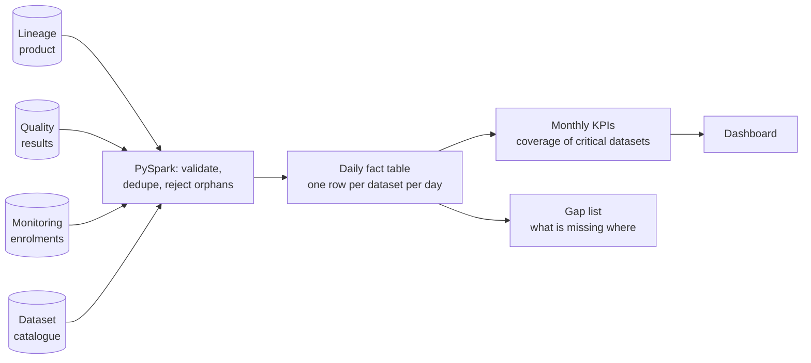
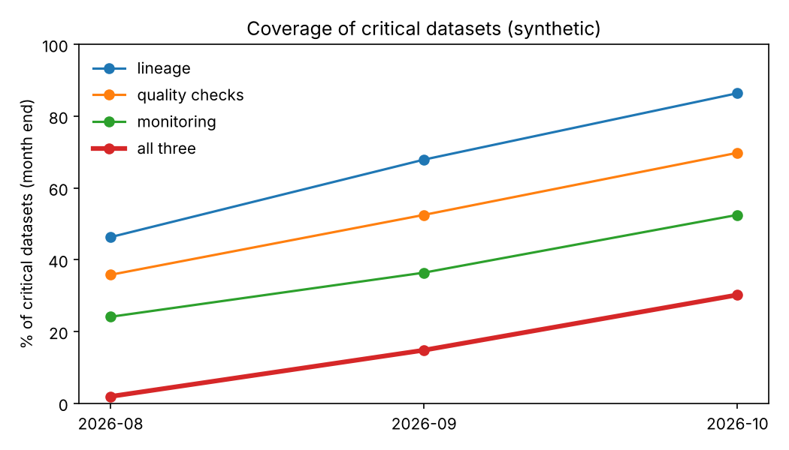
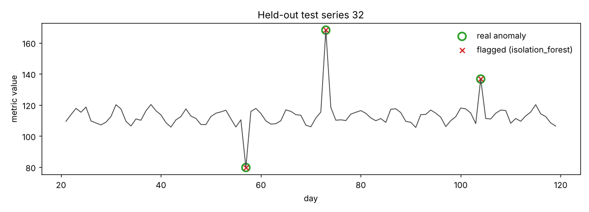

# 03 - Data Observability: one coverage number for the data that matters

> Clean-room re-creation on synthetic data. No employer code, data, metrics or product names.
> Walk-through order: business problem, current architecture, proposed architecture, sample data, algorithms and pipeline, evaluation, business impact.
> **Part A** is the core project (unify three observability tools, report one KPI). **Part B** is an extra experiment of my own (anomaly alerting), kept separate so the two are not confused.

## 1. Business use case

A large data platform ran three separate observability tools: one for **lineage** (what feeds what), one for **data quality** (consistency, validity and timeliness checks) and one for **monitoring and alerts**. Each kept its own database. Leaders asked a simple question every month: *"Of our critical datasets, how many are actually covered, and is that improving?"* Answering it meant exporting from three places and stitching the numbers by hand in a spreadsheet, which took about 40 hours a month and was hard to repeat the same way twice.

**Client question:** "Give us one trusted table and one monthly number for coverage of critical data, without the manual stitching."

Analogy: three security companies guard one building, each with its own logbook. To know which doors are covered by all three, someone copies the logbooks onto one sheet every month. The fix is one shared logbook that updates itself.

A dataset counts as **critical** if it feeds a high-priority use, is tagged to a data product, or holds high-priority data elements.

## 2. Current architecture

| Layer | Today |
|---|---|
| Sources | Three tools, three databases: lineage edges, quality check results, monitor enrolments; plus a dataset catalogue |
| Join | Manual exports and spreadsheet lookups, once a month |
| Reporting | A deck or sheet built by hand |
| Pain | About 40 hours of effort a month (figure from the original project record), inconsistent definitions of "critical", duplicates and orphan rows slipping in, no way to rerun a past month |

<!-- ADD-REAL: confirm the 40 hours/month and the "about 1 hour" after-figure. The same 40 hours appears in the publishing-analytics project, so check whether it is one saving or two. -->

## 3. Proposed architecture



Design choices:
- **One grain:** dataset x day. Every question (coverage, pass rate, gap) is a roll-up of that one table.
- **One definition of critical,** in code (`unify.with_critical_flag`), not in a spreadsheet.
- **Reconciliation built in:** every clean quality check must appear in the fact table exactly once, or the run is marked failed.
- **Rerunnable:** the output is overwritten from the same inputs, so any month can be rebuilt.
- The original ran on a cloud warehouse and a BI tool; here it is PySpark writing CSV, with the KPI layer in pandas, so it runs anywhere.

## 4. Sample data

`scripts/01_generate_sources.py` writes four tables (400 datasets, 92 days): `registry`, `lineage_edges` (538 rows), `dq_results` (38,083), `monitor_enrollment` (150). Coverage by each tool grows over the three months, and I planted real-world problems: 736 duplicate quality rows, 368 rows for a dataset that does not exist, 184 with status "unknown", 2 lineage self-loops and 3 repeated monitor rows. Because I know exactly what I planted, the pipeline can be checked against it.

```python
# observability/sources.py (excerpt)
critical = registry[["feeds_high_priority_use", "tagged_data_product", "has_high_priority_elements"]].any(axis=1)
p = np.where(critical, COVERAGE_END["critical"][product], COVERAGE_END["other"][product])
```

## 5. Algorithms and pipeline

This part is data engineering, not model fitting. The "algorithm" is a chain of exact steps (`observability/unify.py`):

1. **Clean quality results:** keep known dataset, valid check type (consistency/validity/timeliness), status pass or fail, real date; drop repeated result ids.
2. **Clean lineage:** drop self-loops and unknown datasets; keep the first date each dataset had lineage.
3. **Clean monitoring:** one row per dataset, earliest enrolment date.
4. **Build the daily fact:** every dataset x every day, with `has_lineage`, `is_monitored`, checks run and passed by type.
5. **Monthly KPIs** (`kpi.py`, pandas): at month end, % of critical datasets with lineage, with any quality check that month, with monitoring, and with **all three**.

```python
cov = crit.groupby("month").agg(lineage_pct=("has_lineage", "mean"), quality_pct=("has_quality", "mean"),
                                monitoring_pct=("is_monitored", "mean"), fully_covered_pct=("fully_covered", "mean"))
```

Spark is used for the joins and the 400 x 92 expansion; the monthly roll-up is tiny, so it stays in pandas.

## 6. Evaluation

No model to tune here, so evaluation is correctness:

```bash
python scripts/01_generate_sources.py
python scripts/02_build_unified_table.py     # needs Java 17/21 + PySpark
python scripts/03_monthly_kpis.py            # reports/unified/*.csv + coverage.png
pytest projects/03-data-observability -q     # 19 pass
```

- Rejected rows equal the planted problems exactly (1,288 = 736 + 368 + 184).
- Reconciliation passes: fact-table check and pass totals equal the clean data.
- An **independent pandas calculation** straight from the raw CSVs gives the same fully-covered % as the Spark pipeline.
- Rerunning gives identical counts.

## 7. Results (synthetic data)

| Month | Lineage | Quality | Monitoring | **All three** | Change (pts) | Overall pass rate |
|---|---|---|---|---|---|---|
| 2026-08 | 46.3% | 35.8% | 24.1% | **1.9%** | n/a | 93.6% |
| 2026-09 | 67.9% | 52.5% | 36.4% | **14.8%** | +12.9 | 93.9% |
| 2026-10 | 86.4% | 69.8% | 52.5% | **30.2%** | +15.4 | 94.2% |

Timeliness checks fail most (about 90% pass versus 97% for consistency). `reports/unified/coverage_gaps.csv` lists the 113 critical datasets still missing a product in October, and which one.



These numbers come from my generator, so they show the pipeline works, not what any real platform achieved. "All three" is far below each single number because a dataset must clear every gap.

## 8. Business impact

The original outcome, taken from the project record: monthly reporting effort fell from about **40 hours to about 1 hour**, and leaders got a repeatable month-over-month view. I cannot reproduce the underlying figures here, and this demo does not measure them.

To size it for another client: hours saved = (manual hours - automated hours) x months; add the value of acting on the gap list (closing coverage on critical data first).

<!-- ADD-REAL: your own words on adoption, who used the KPI, and what coverage moved from/to. Only numbers you can defend. -->

## Part B. Extra experiment: alerting on metric anomalies (my addition)

Not part of the original work. A small benchmark of how to alert when a table metric (row count, null rate, freshness) looks wrong, tuned on labeled history. Analogy: a smoke detector that must ring for real fires, not toast.

### B1. Sample data

`scripts/alerts_01_generate_data.py` writes `data/sample/labeled_metrics.csv`: 40 metrics x 120 days, each with a weekly rhythm, noise, and 3 injected problems of 12% to 50% of normal level. Because we know which days are broken, we can score the detectors.

```python
# observability/labeled_data.py (excerpt)
weekly = 0.04 * level * np.sin(2 * np.pi * np.arange(days) / 7 + phase)
values = level + weekly + noise
values[d] += size * rng.choice([-1, 1])      # inject a problem on day d
```

120 labeled anomalies out of 4,800 days (2.5%).

### B2. Algorithms compared

All four score each day using only the previous 21 days (`observability/benchmark.py`).

| Method | Idea | Weak spot |
|---|---|---|
| `zscore` | distance from mean in standard deviations | one old outlier inflates the std and hides the next |
| `robust_z` | same with median and MAD | slightly noisier on short windows |
| `iqr` | distance outside the middle 50% of recent days | coarse on small windows |
| `isolation_forest` | unsupervised model on 3 features (robust z, plain z, % deviation) | harder to explain to a client |

```python
def _robust_z(f):
    scale = np.maximum.reduce([1.4826 * f["mad"], 0.01 * f["median"].abs(), np.full(len(f), 1e-9)])
    return (f["value"] - f["median"]) / scale
```

### B3. Training, model selection and tuning

Split **by metric**, not by day, so the test metrics are ones the detector has never seen:

| Split | Metrics | Purpose |
|---|---|---|
| Train | 0-23 | fit the isolation forest; set candidate thresholds |
| Validation | 24-31 | pick each method's best threshold by F1, then pick the best method |
| Test | 32-39 | scored once, at the end |

```bash
python scripts/alerts_01_generate_data.py
python scripts/alerts_02_tune_and_select.py     # reports/validation_comparison.csv
python scripts/alerts_03_evaluate_holdout.py    # reports/test_comparison.csv + figures/test_series.png
```

Validation winner: `isolation_forest` (F1 1.00), then `robust_z` at threshold 3.5 (F1 0.98).

### B4. Test results (8 unseen metrics, 24 anomalies)

| Method | Threshold | Precision | Recall | F1 | False alarms | Missed |
|---|---|---|---|---|---|---|
| isolation_forest | 0.134 | 1.00 | 1.00 | 1.00 | 0 | 0 |
| iqr | 2.0 | 1.00 | 0.96 | 0.98 | 0 | 1 |
| robust_z | 3.5 | 0.96 | 0.96 | 0.96 | 1 | 1 |
| zscore | 3.0 | 1.00 | 0.92 | 0.96 | 0 | 2 |



**Read this honestly.** All four methods land within 4 F1 points, and the perfect forest score on 24 anomalies is not proof it is better. My synthetic problems are simple one-day jumps on a clean weekly pattern, which is easy for every method. On real data with drift, holidays and gradual decay, expect lower scores and bigger gaps. In a real engagement I would still **ship `robust_z`** first: it is explainable ("today is 6 normal-swings above the median"), needs no training, and is within a hair of the best. I would move to the forest only if labeled incidents showed it catching things the simple method misses.

The older end-to-end demo (`python -m observability --out report.md`) still runs the 3-problem scenario with the markdown report and LLM-summary hook.

**Read this honestly.** All four methods land within 4 F1 points, and a perfect forest score on 24 anomalies is not proof it is better. My synthetic problems are one-day jumps on a clean weekly pattern, which is easy. On real data expect lower scores. I would ship `robust_z` first: explainable, no training, near the best.

The older end-to-end demo (`python -m observability --out report.md`) still runs a 3-problem scenario with a markdown report and LLM-summary hook.

## Limits

- Synthetic data; coverage growth and pass rates are made up.
- Month-end snapshot semantics: lineage and monitoring are judged on the last day; "quality" means any check ran that month.
- No row-level security, scheduling or dashboard here; the original used a warehouse and BI tool.
- Part B scores each metric alone and has no seasonality or root-cause grouping.

## Files

```
observability/sources.py      synthetic four-table generator       unify.py       PySpark cleaning + daily fact
observability/lake_pipeline.py  run, reconcile, manifest           kpi.py         monthly KPIs and gap list
scripts/01-03_*.py            Part A steps                         scripts/alerts_*.py  Part B steps
observability/detect.py, benchmark.py, labeled_data.py  Part B
```
