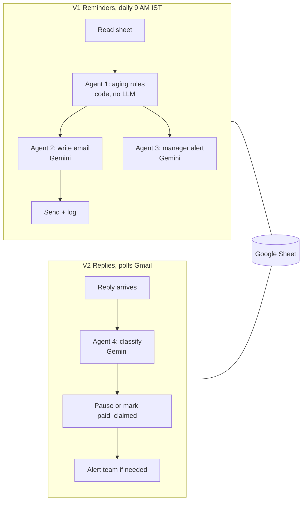

# 04 - Hospital Receivables Collections Agent (n8n + Gemini)

> Demo build on dummy patients and example.com addresses. Adapted from a community "Collections Follow-Up Agent" template for agencies (credited in `docs/architecture.md`); the hospital design, rules, fixes and tests are the work shown here.
> Walk-through order: business problem, current architecture, proposed architecture, sample data and code, how the agents decide, testing and evaluation, business impact.

## 1. Business use case

A hospital bills corporate payers for employee treatment. Many of those bills sit unpaid for months. Billing staff chase them by hand: find the overdue bills, write an email, send it, remember to follow up, notice a reply. Chasing is inconsistent, replies get missed, and old bills surface late.

**The client question:** "Can we collect overdue corporate bills faster, politely, without adding staff, and without exposing patient information?"

Analogy: a very organised assistant who checks the ledger every morning at 9, sends the right-toned nudge, stops nagging the moment someone replies, and taps the manager on the shoulder only when a human is needed.

## 2. Current architecture

| Layer | Today |
|---|---|
| Source | A Google Sheet the billing department updates daily (manual) |
| Chasing | Staff read the sheet, write and send emails by hand |
| Replies | A shared Gmail inbox, read when someone remembers |
| Pain | Follow-ups depend on memory; tone varies; 90+ day bills surface late; no record of what was sent |

No APIs, no database. That is why the first version keeps the sheet as the system of record.

## 3. Proposed architecture

Two n8n workflows share one Google Sheet.



Full diagram, sheet schema, decision table and privacy design: [`docs/architecture.md`](docs/architecture.md).

**Key design choices**
- **Agent 1 is code, not an LLM.** Dates and cooldowns are exact rules. No wrong dates, no API cost for that step.
- **The sheet is the memory.** `paused_until`, `status`, `last_reminded_at`, `last_escalated_at` let V1 respect what V2 learned.
- **"Already paid" becomes `paid_claimed`, not `paid`.** A claim is not proof; staff confirm the receipt.
- **Privacy by prompt.** Gemini sees first name, bill number, amount and dates. Not department, diagnosis or (in Agents 2 and 4) phone numbers.

## 4. Sample data and code

`data/bills.csv`: 11 dummy bills, each built to test one rule (not due, 10 / 20 / 40 / 70 / 100 days overdue, recently reminded, paused, paid_claimed, bad date, insurance-paid).

The n8n Code node and its Python twin:

```js
// n8n/agent1_aging_analyser.js (excerpt)
if (daysOverdue < 0)        { bucket = 'not_due'; tone = 'none';         gap = null; }
else if (daysOverdue <= 15) { bucket = '0-15';    tone = 'gentle';       gap = 7; }
else if (daysOverdue <= 30) { bucket = '16-30';   tone = 'firm';         gap = 5; }
else if (daysOverdue <= 60) { bucket = '31-60';   tone = 'urgent';       gap = 3; }
else if (daysOverdue <= 90) { bucket = '61-90';   tone = 'final_notice'; gap = 7; }
else                        { bucket = '90+';     tone = 'escalate';     gap = null; }
```

Run the demo (dry run: writes drafts to `outbox/`, sends nothing):

```bash
python -m receivables_agent --bills data/bills.csv --as-of 2026-11-08
# 4 reminder(s) and 2 manager alert(s) drafted (dry run)
```

Prompts for the three Gemini agents, with temperatures and parser examples: [`n8n/prompts/`](n8n/prompts/).

**Importable workflows.** `n8n/workflows/patient_collections_v1.json` (19 nodes) and `..._v2.json` (12 nodes) are generated by `n8n/build_workflows.py` from the Code node and prompt files, so the pieces cannot drift apart. `n8n/sample_sheet/Patient_Collections_AR.xlsx` holds the four tabs with the 11 dummy bills. They carry no credentials or real addresses; after import, replace `REPLACE_WITH_SHEET_ID` and `REPLACE_WITH_MANAGER_EMAIL` and attach your own Google and Gemini credentials. **These were written from the build guide, not exported from a running n8n.** They were imported into n8n 2.35.7 with its own `import:workflow` command, which accepted both and stored 19 and 12 nodes. That checks the file format only: I did not open them in the editor, attach credentials or execute them, so expect to fix small node-setting details on first run. Tests check the graph (every connection valid, nothing orphaned, wiring matches the guide, no credentials or emails), and the Code node inside is the same file that is tested against Python.

## 5. How the agents decide

| Agent | Job | Engine | Output |
|---|---|---|---|
| 1 Aging Analyser | days overdue, bucket, tone, should we email, should we alert | JavaScript Code node (+ Python twin) | `days_overdue, aging_bucket, tone_grade, should_remind, escalate_now, cooldown_reason` |
| 2 Reminder Writer | polite email, tone graded by age, no medical detail | Gemini, temp 0.4 | `email_subject, email_body` |
| 3 Escalation Writer | phone-first alert with a specific action for the manager | Gemini, temp 0.2 | `alert_subject, alert_body` |
| 4 Reply Classifier | intent, pause length, urgency, human needed | Gemini, temp 0.2 | `intent, promised_date, pause_days, summary, urgency, needs_human` |

Reminder gaps: 7 days (0-15), 5 (16-30), 3 (31-60), 7 (61-90). Over 90 days: no patient email, manager alert only. Manager alert from 60 days, at most once every 7 days. Pauses after a reply: 15 days (paying soon), 5 (silent ack), 7 (disputing, angry, payment plan), 30 (already paid, insurance pending), 3 (unclear), 90 (wrong contact).

## 6. Testing and evaluation

**Rules (exact):** `pytest projects/04-hospital-receivables-agent` runs 33 tests: bucket boundaries, every case in the test plan, dry run changes nothing, department and phone never reach reminder emails, cooldowns hold after a send, pauses expire correctly, and the **JavaScript Code node gives identical answers to the Python rules** on three different dates.

**Reply classification (statistical):** `python scripts/evaluate_reply_classifier.py` scores a keyword baseline on 40 labeled replies:

| Metric | Keyword baseline |
|---|---|
| Accuracy | 92% (37 of 40) |
| Replies needing a human that were routed to one | 96% |
| Weakest intents | silent_ack 60%, already_paid 75% |

Be careful how you read this. I wrote the rules and the labeled replies myself, so 92% is optimistic. The three misses are paraphrases with no trigger word, for example "The amount has been paid, receipt enclosed" read as `unclear`, which would mean chasing someone who already paid. That is the case for a Gemini classifier. **I have not run Gemini on these replies, so there is no LLM accuracy figure here.** The `evaluate()` function accepts any classifier, so it is ready for that test.

Live flow tests (11 steps with real Gmail and Gemini, dummy patients) are in [`docs/build-notes.md`](docs/build-notes.md).

## 7. Business impact

What the system changes:

| Lever | How it helps |
|---|---|
| Staff time | Reminders drafted and sent automatically; staff handle only escalations and disputes |
| Cash collected sooner | Consistent follow-up on a fixed cadence, nothing forgotten |
| SLA | Replies classified within a minute; human-needed replies alerted immediately |
| Risk | No medical detail in emails; paid claims confirmed by staff before a bill is closed |

`python scripts/estimate_impact.py` turns that into rupees with **placeholder assumptions** (300 open bills, 25,000 INR average, 3 manual reminders a month, 8 minutes each, 5 days sooner). With those inputs: about 108 staff hours and INR 27,000 of staff cost per month, plus INR 10,000 of financing cost, about INR 37,000 a month. These numbers are a worked example, not a result. Replace every input with the hospital's own figures.

The template's slides claim agencies lose 15 to 25% of billable revenue to late payment. That is the course's marketing claim, not something measured here.

<!-- ADD-REAL: what you actually observed in the demo or any pilot: number of bills, emails sent, replies handled, time saved. If nothing was deployed, say "demo only". -->

## 8. Limits and next steps

- Demo mailbox and dummy data only. Real patient data needs paid Gemini, hospital IT and compliance sign-off.
- V2 accepts any sender with a bill number in the subject (build-note 9). A sender check against the sheet is the next fix.
- Google Sheet is fine for a demo; a database and a CSV or API feed from the hospital system is the production path.
- Extensions to consider: weekly summary for the accounts manager, payment links, WhatsApp copy.

## Files

```
data/bills.csv, labeled_replies.csv     dummy sheet rows, labeled replies
n8n/agent1_aging_analyser.js            Code node (verbatim logic)   n8n/prompts/  Gemini prompts
n8n/workflows/, sample_sheet/           generated V1 and V2 workflows, 4-tab sample sheet
n8n/build_workflows.py                  regenerates them from the files above
receivables_agent/                      Python twin: aging.py, agent.py, replies.py
scripts/                                evaluate_reply_classifier.py, estimate_impact.py
docs/architecture.md, build-notes.md    design, 12 fixes, test plan
```
