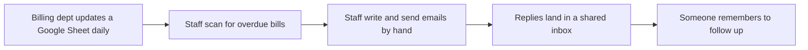
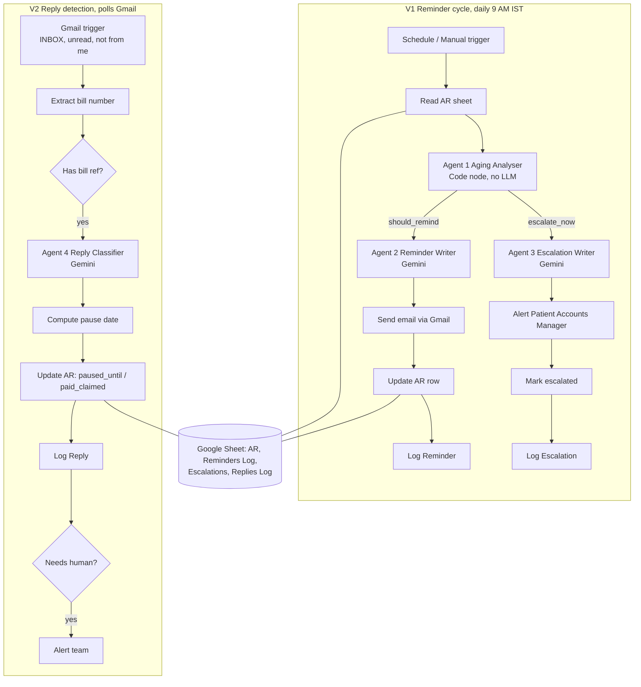

# Architecture

## Where this started

The base design is a **Collections Follow-Up Agent** from a community "rebuild pack" for Indian agencies
(two n8n workflows, four Gemini agents, one Google Sheet), used here as the starting point. It chases
agency invoices and escalates to a founder. Its decks, screenshots and workflow files belong to that
course and are not redistributed in this repo.

The **hospital adaptation** is the work documented here: different debtors, privacy limits, a stricter
rule engine and a reworked test plan. See `build-notes.md` for every change.

## Current process (typical, before automation)

Sources: one manually maintained Google Sheet (billing department), Gmail inbox. No APIs, no database.
Pain: follow-ups depend on memory, tone is inconsistent, replies are missed, bills past 90 days surface late.

## Proposed architecture

V1 sends and V2 listens. The **sheet is the only shared state**: `paused_until`, `status`,
`last_reminded_at` and `last_escalated_at` are how V1 knows what V2 learned.

## Decision rules (Agent 1)

| Bucket | Days overdue | Tone | Gap between reminders | Who acts |
|---|---|---|---|---|
| not_due | below 0 | none | none | nobody |
| 0-15 | 0 to 15 | gentle | 7 days | email |
| 16-30 | 16 to 30 | firm | 5 days | email |
| 31-60 | 31 to 60 | urgent | 3 days | email |
| 61-90 | 61 to 90 | final_notice | 7 days | email, plus manager alert |
| 90+ | above 90 | escalate | no patient email | manager alert only |

Skipped when: status is `paid`, `paid_claimed`, `closed` or `waived`; or today is before `paused_until`.
Manager alert: 60 or more days overdue and no alert in the last 7 days.
Quirk worth knowing: the alert starts at 60 days while the `61-90` bucket starts at 61, so a bill at
exactly 60 days gets an alert with an `urgent` (not `final_notice`) email.

## Data model (Google Sheet, four tabs)

| Tab | Purpose | Columns |
|---|---|---|
| AR | live ledger | invoice_no, patient_name, patient_contact_no, payer_type, payer_org, payer_email, department, invoice_amount, currency, due_date, status, notes, last_reminded_at, reminder_count, paused_until, last_reply_at, reply_summary, days_overdue, aging_bucket, last_escalated_at |
| Reminders Log | every email sent | invoice_no, patient_name, sent_at, aging_bucket, tone_grade, email_subject, email_body, reminder_count |
| Escalations | manager's list | invoice_no, patient_name, patient_contact_no, department, invoice_amount, days_overdue, escalated_at, manager_action_needed |
| Replies Log | every reply, classified | invoice_no, from_name, from_email, received_at, subject, body_preview, intent, promised_date, pause_days, summary, urgency, needs_human |

## Stack

| Piece | Choice | Why |
|---|---|---|
| Orchestration | n8n | visual flow the hospital's team can read; hosting decision postponed until it works |
| LLM | Gemini Flash-Lite class model, paid tier before real data | free-tier terms allow product-improvement use of prompts |
| State | Google Sheets | the billing team already maintains one |
| Email | Gmail (dummy mailbox for the demo) | send and poll replies |

## Privacy design

- Gemini sees first name, bill number, amount and dates. No diagnosis, no department, no phone number in Agents 2 and 4.
- Only the manager alert prompt (Agent 3) carries the contact number, so staff can phone.
- Replies Log can hold health details: restrict who can open that tab.
- Names, contacts and amounts are personal data under India's DPDP Act 2023. Hospital IT and compliance
  must approve where the sheet lives, retention, and whether patients agreed to email contact. This repo
  and its author make no legal claim.
