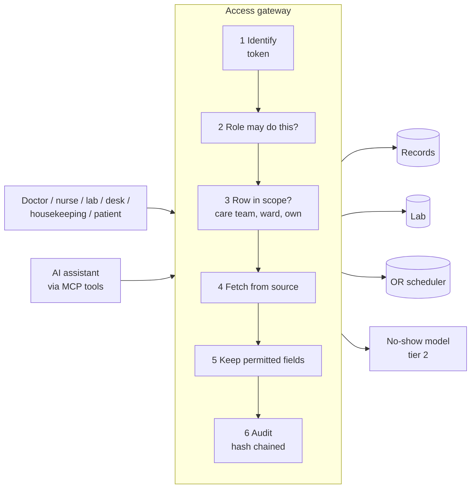

# 05 - Clinical Access Gateway: one front door to many hospital systems

> Synthetic data only: invented patients, doctors and results; three mock systems stand in for a hospital's real ones. Not a medical or compliance product.
> Walk-through order: business problem, current architecture, proposed architecture, sample data and code, how access is decided (and the AI tier), tests and evaluation, business impact.
> **Part A** is the gateway. **Part B** is the plain-English query layer I built first (rules-based translator with a held-out test); it plugs in as a front end.

## 1. Business use case

A hospital runs many separate applications: records, lab, scheduling, billing, plus a data platform. Doctors, nurses, lab staff, front desk, housekeeping and patients each need a small slice of different systems. Today they log in to several screens, or ask someone with access. Hospitals also want AI assistants over this data, and the blocker is always the same question: **who is allowed to see what, and can you prove it afterwards?**

**Client question:** "Can our staff and our AI tools reach the data they need from one place, without anyone seeing what they should not, and without copying our data anywhere?"

Analogy: a hotel front desk with a master key system. Every guest and staff member asks the same desk, the desk checks who they are and which doors their key opens, hands over only what is allowed, and writes every request in a ledger that cannot be quietly edited.

**Positioning.** In-house IT teams can connect to APIs; that part is not scarce. What is scarce is a **governed layer** with row-level rules, emergency access and an audit trail that a compliance officer accepts. The gateway **holds no data**: it asks each system on every request, filters, and forgets.

## 2. Current architecture

| Layer | Today |
|---|---|
| Systems | Separate applications for records, lab, OR scheduling, billing; each with its own login and roles |
| Access | Per-application roles; ad hoc exports; shared logins in busy areas |
| AI | Pilots that either have no access to real data or too much of it |
| Pain | Staff hop between screens; access is checked per application, not per patient relationship; no single record of who looked at what |

<!-- ADD-REAL: the actual systems, vendors and integration standards at the clients you have visited (HIMS, lab, FHIR/ABDM endpoints). Keep client names out of the public repo. -->

## 3. Proposed architecture



Design choices:
- **Deny by default.** One policy table (`gateway/policy.py`) lists role, resource, actions, fields and row scope. Anything missing is refused.
- **Roles are not enough.** A doctor sees patients on **their** list, a nurse sees **their ward**, a patient sees **themselves**. That is the relationship check hospitals actually need.
- **Denied and missing look the same,** so a caller cannot find out which patient ids exist.
- **Break-glass:** a doctor or nurse can read outside their scope in an emergency with a written reason. Role field limits still apply, the access is flagged, and it lands in a review queue.
- **Tamper-evident audit:** each log line carries the hash of the previous one (`audit.py`). Edits and deletions are detected.
- **Two tiers.** Tier 1 is deterministic lookups and actions with no AI. Tier 2 adds a prediction (appointment no-shows) where it earns its keep.
- **MCP front end** (`gateway/mcp_server.py`): five tools, so any MCP-capable assistant uses the hospital's systems only through the gateway. The model cannot widen its own access because the policy is code, not a prompt.

## 4. Sample data and code

Three mock systems (`gateway/systems.py`): 6 patients in wards A and B with diagnoses, medications and allergies; 6 lab results; an OR scheduler with two rooms and four slots a day (one slot booked, one waiting to be cleaned). Ten demo users across six roles (`gateway/users.py`).

```python
# gateway/policy.py (excerpt)
("doctor", "patient_record"): {"actions": {"read"}, "scope": "care_team",
                               "fields": ["patient_id", "name", "dob", "ward", "diagnosis", "medications", "allergies"]},
("nurse",  "patient_record"): {"actions": {"read"}, "scope": "ward",
                               "fields": ["patient_id", "name", "ward", "medications", "allergies"]},
("housekeeping", "or_cleaning"): {"actions": {"mark_cleaned"}, "scope": "all", "fields": []},
```

```python
from gateway import Gateway
gw = Gateway("audit.jsonl")
gw.request("tok-rao", "patient_record", "read", {"patient_id": 1})    # ok: on Dr Rao's list
gw.request("tok-rao", "patient_record", "read", {"patient_id": 3})    # denied: Dr Iyer's patient
gw.request("tok-rao", "patient_record", "read", {"patient_id": 3},
           break_glass_reason="ER arrival, unconscious, covering Dr Iyer")   # ok, flagged for review
```

`python scripts/02_access_matrix.py` runs every user against every resource and writes `reports/access_matrix.csv`. Example rows: the doctor sees diagnosis; the nurse in the right ward sees medications and allergies but no diagnosis; the front desk sees name and phone only; housekeeping sees room states and nothing about patients.

## 5. How access is decided, and the AI tier

**Tier 1 (no AI):** read a record, read lab results, check which OR slots are free, book a slot for your own patient (conflict checked), mark a room cleaned. Doctors cannot book a slot waiting to be cleaned until housekeeping clears it.

**Tier 2 (AI): appointment no-show risk.** An empty slot is lost revenue and a longer wait for someone else. Scoring upcoming appointments lets the front desk remind the riskiest first. Only the front desk can read the scores, and only patient id and risk.

Models compared (`gateway/predict.py`): logistic regression (three regularisation strengths) and gradient boosting (four depth and learning-rate settings). Features: lead days, prior no-shows, age, distance, reminder sent, new patient, Monday.

**Split and selection:** 6,000 synthetic appointments by date: first 60% train, next 20% validation, last 20% test. Pick by validation AUC, refit on train plus validation, score test once.

| Validation AUC | |
|---|---|
| logistic C=1.0 | **0.736** |
| gradient boosting depth 2, lr 0.05 | 0.731 |
| gradient boosting depth 4, lr 0.1 | 0.705 |

**Test (1,200 appointments, run once):** AUC **0.729**. The riskiest 20% of appointments contain **39%** of all no-shows (random would give 20%; a rule using prior no-shows only gives 27%, AUC 0.56).

Be straight about it: logistic regression won because **my generator is a logistic rule**, so this says little about which model suits a real hospital. What it shows is the evaluation method and that the score ranks risk well on data where risk is learnable. Real data would need a re-run, plus a fairness check so the score never becomes a reason to deny care.

## 6. Tests and evaluation

```bash
python scripts/02_access_matrix.py
python scripts/03_evaluate_no_show.py
pytest projects/05-clinical-access-gateway -q      # 37 pass
```

- **Access rules:** doctor, nurse and patient row scopes; field limits per role; housekeeping never sees patient data; list requests return only what you may see; forbidden and missing look identical.
- **Deny by default:** unknown token, unlisted role and resource, forbidden actions, malformed parameters (an SQL-looking patient id is refused, not crashed on).
- **Break-glass:** needs a reason of 10+ characters, is flagged, keeps role field limits, is unavailable to housekeeping, lab, patients and cannot cross a patient's own boundary.
- **Writes:** only your own patient, no double booking, cleaning gate respected.
- **Audit:** denials are logged; editing a line or deleting one makes `verify()` fail and points at the first bad line.
- **MCP:** the five tools are listed and call the same policy (this test is skipped if the 2.x `mcp` package is not installed).

## 7. Business impact

| Lever | How it helps |
|---|---|
| Staff time | One place instead of several screens; OR availability in seconds |
| Risk | Row-level access, break-glass review and a verifiable audit trail answer the compliance question before AI is switched on |
| AI readiness | Assistants get a narrow, governed door instead of a database login |
| Revenue | No-show scoring targets reminders where they matter |

Illustrative arithmetic for the no-show tier, **assumptions are mine, not measured**: 200 appointments a day at the 27% no-show rate is about 54 empty slots; reminders to the riskiest 20% (40 appointments) reach 39% of no-shows, about 21; if a call prevents 30% of those, about 6 slots a day are saved, and at an assumed INR 800 a slot that is about INR 5,000 a day. Replace every input with the hospital's own figures; the real reminder effect needs a pilot with a control group.

<!-- ADD-REAL: measured outcomes from any pilot or client conversation (request volumes, time saved, slots recovered). If it is demo-only, say so. -->

## Limits and what a real deployment needs

- Mock systems and a token table. Production: the hospital's single sign-on, FHIR or vendor APIs, a service identity per system, and network isolation.
- In the MCP demo the token is a tool argument. In production it is bound to the authenticated session so a model cannot choose it.
- No patient-consent registry, purpose-of-use rules, field-level encryption, rate limits or alerting on unusual access.
- The audit chain is verifiable but the demo keeps it in one file; production ships the latest hash to a separate system.
- Not certified for any regime. India's health-data rules and the hospital's own policies need a compliance review before real data.
- Row scope is a simple list or ward; real care teams change by shift, consult and transfer.

## Files

```
gateway/         policy.py, gateway.py, audit.py, systems.py, users.py, predict.py, mcp_server.py
clinic_query/    Part B: plain-English query layer
scripts/         02_access_matrix.py, 03_evaluate_no_show.py, 04_evaluate_translator.py
reports/         access_matrix.csv, no_show_evaluation.json, evaluation.json
```

---

## Part B. Plain-English questions over a clinic database (built first)

The language model never writes SQL. It produces a small structured plan; the code checks it against the caller's role and builds parameterised SQL on a read-only connection. Package `clinic_query/`. It can sit in front of the gateway as the language layer.

### B1. The translator: methods compared

| Translator | Status here | Strength | Weakness |
|---|---|---|---|
| Keyword rules (`RuleBasedTranslator`) | built, scored below | free, instant, predictable | only knows the phrasings I wrote |
| LLM returning a JSON plan | interface ready (`plan_from_json`), **not run** | handles paraphrase | needs scoring on real questions, costs money, can misread |

I did not run an LLM here, so there is no LLM accuracy number.

### B2. Tuning and selection

Labeled questions with the expected plan, split in two (`data/questions_dev.json`, `questions_test.json`, 20 each, roles mixed, two "refuse this" cases each).

1. Write the rules, score the **dev** set: 18 of 20 right. Misses: "list patients from Vizag", "list patients whose city is Chennai".
2. Fix the city rule using only those dev misses.
3. Score dev again: 20 of 20. Dev is now tuned, so it is not an honest estimate any more.
4. Score the **test** set once.

```bash
python scripts/04_evaluate_translator.py all
```

Scoring has two levels: **plan match** (same table, aggregate and filters) and **answer match** (running the plan returns the same rows as the expected plan).

### B3. Test results

| Set | Questions | Plan accuracy | Answer accuracy |
|---|---|---|---|
| Dev (tuned on) | 20 | 100% | 100% |
| **Test (run once)** | 20 | **80%** | **80%** |

The four test misses, all paraphrases the rules had never seen:

| Question | What went wrong |
|---|---|
| "who is booked with Dr Khan" | "booked" is not in the keyword list |
| "what do patients owe" | found invoices but did not add the unpaid filter |
| "outstanding balance" | no rule for it, so it declined |
| "who hasn't paid" | read "paid" and **silently chose the wrong filter** |

The last one matters most. A refusal is safe; a confident wrong answer is not. Whatever translator is used, the interface should show how it understood the question ("showing: invoices, status = paid") so a person can catch it, and an LLM translator should be scored on a much larger set of real questions before anyone relies on it.

**Security checks** (`run_attacks`): 12 attempts plus one integrity check, all passed. They include a role reading another role's table, hidden columns used in a column list, a filter and a sum, SQL smuggled into the operator, filter column and selected columns, reading the database's own catalogue, an unknown role, injection text as a value (stays a bound parameter, nothing runs), and a huge row limit (capped at 100). After all attacks the table row counts are unchanged, and the connection itself is read-only. These pass because of how the code is built, not because a model behaved.

14 tests: `pytest projects/05-clinical-access-gateway`.

### B4. Security checks

`run_attacks` runs 12 attempts and one integrity check: role reading another role's table, hidden columns, SQL smuggled into operators and column names, reading the catalogue, an unknown role, injection text as a value (stays a bound parameter), and a huge row limit (capped at 100). All pass, because of how the code is built, not because a model behaved.
